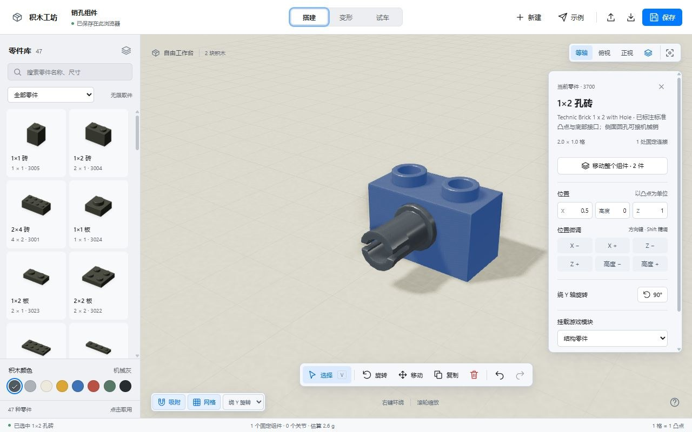
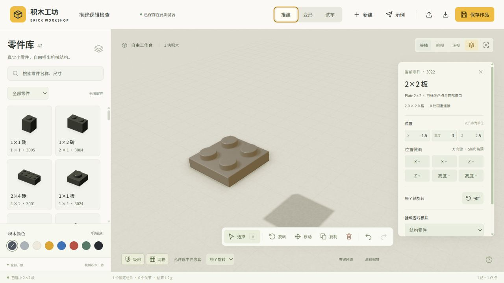
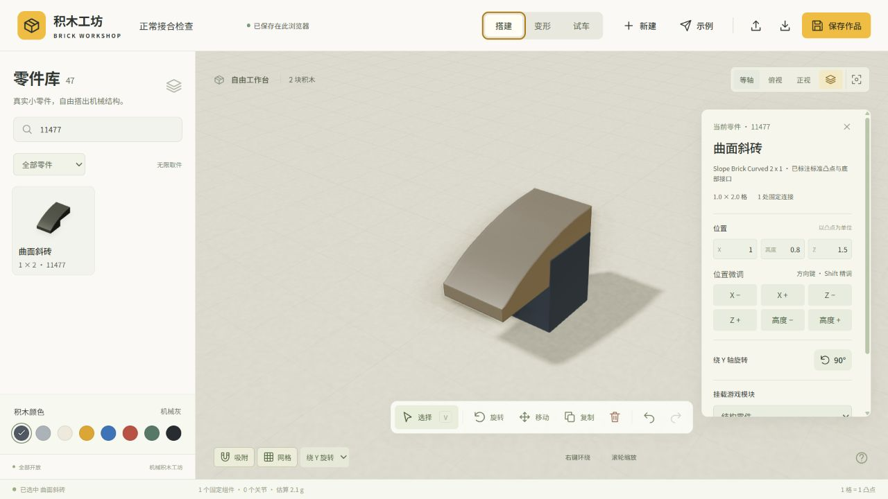
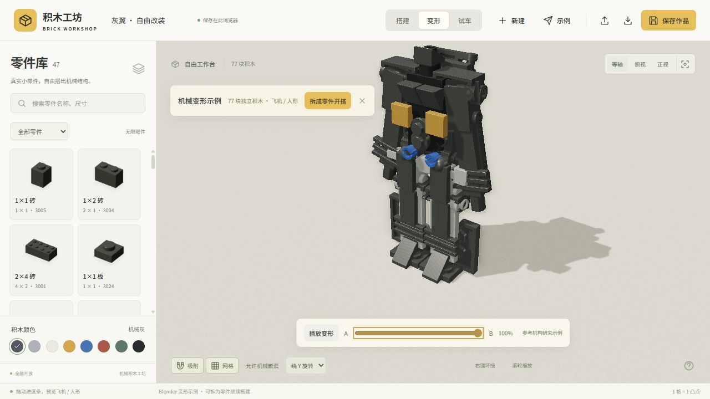
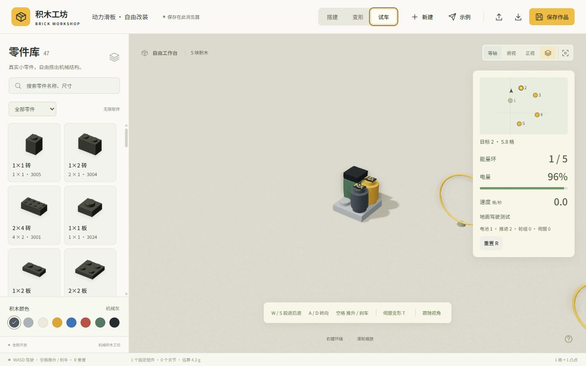
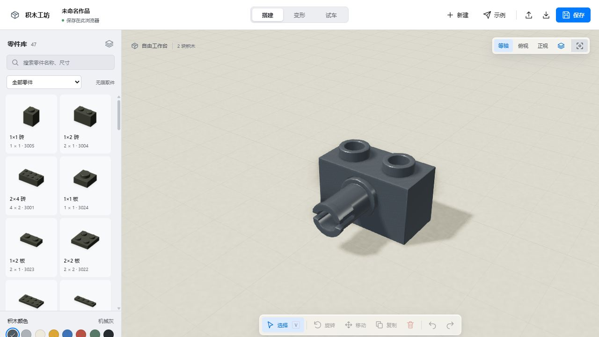
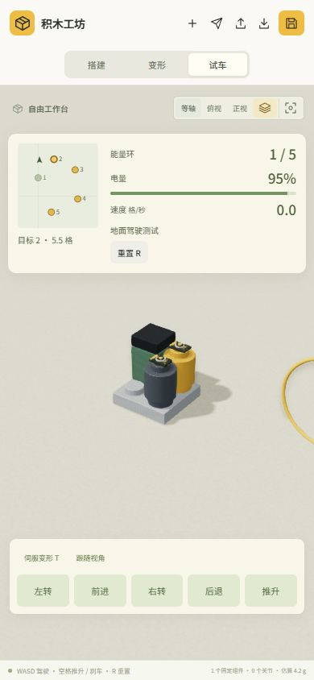
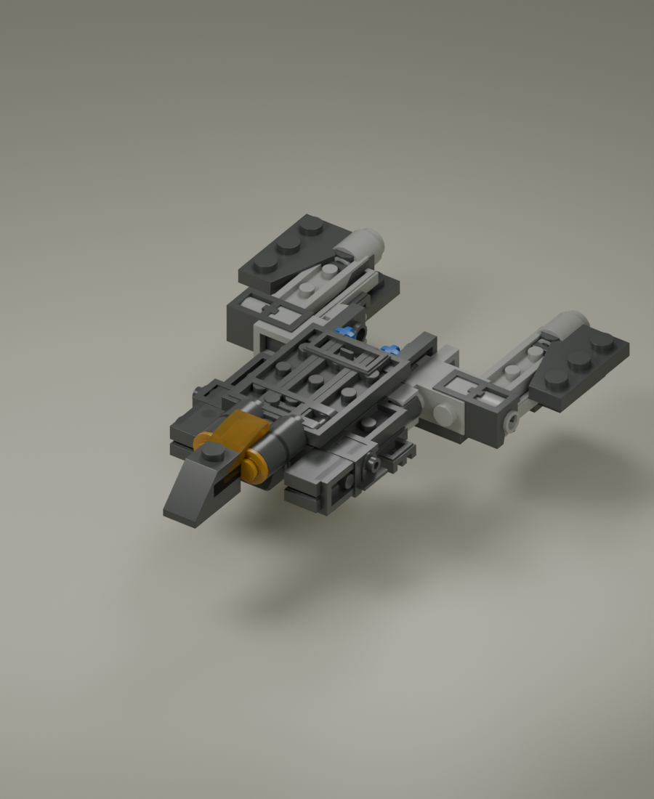
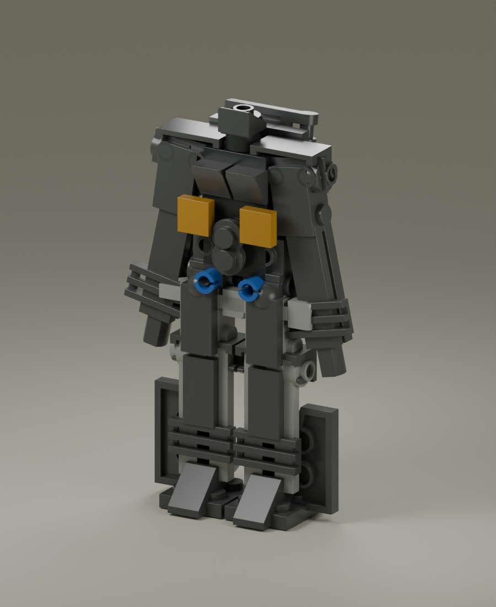

# 积木工坊 · Brick Workshop

一个开放式 3D 机械积木沙盒：从零件开始自由搭建，设置关节与姿态，再给作品装上动力模块进行试车。零件模型在 Blender 中制作，游戏使用 Three.js 在浏览器运行。



<p align="center"><b>自由搭建</b> · <b>机械关节</b> · <b>动力试车</b></p>

## 能做什么

- **自由搭建**：47 种 Blender 零件、8 种颜色、搜索与分类，支持三轴旋转、复制、单件或整组件移动、撤销和重做。
- **真实接口**：已核验的标准凸点、底孔和常用机械销孔可自动接合；碰撞和支撑检查帮助避免穿插与悬空。
- **变形**：设置父子组件、轴心、旋转轴、限位与 A/B 姿态，保存命名姿态并预览动作。
- **功能模块**：为零件挂载电池、推进器、轮组或伺服，连接关系影响组件供能。
- **试车**：在场地中驾驶作品、切换姿态并收集能量环。
- **保存**：自动存入当前浏览器，支持 JSON 导入与导出。

## 画面

### 搭建与接合

| 自由搭建 · 选中零件与位置微调 | 接口校验 · 曲面斜砖与属性面板 |
| --- | --- |
|  |  |

工作台默认空白：从左侧零件库取件，在中央 3D 区域放置、旋转与微调；右侧面板显示选中件的接口、位置与可挂载模块。放置时按标准凸点、底孔与销孔建立连接，并做碰撞与支撑检查。

### 变形与试车

| 77 件机甲 · A/B 姿态变形 | 动力试车 · 能量环与仪表 |
| --- | --- |
|  |  |

左图为 77 件积木组成的机甲研究示例，可用滑块预览飞机形与人形之间的姿态；右图为挂载电池与推进模块后的试车画面，右上角显示小地图、能量环、电量与速度。两张均为早期版本界面。

### 界面与窄屏

| 毛玻璃面板 · v0.6 | 390 × 844 窄屏 |
| --- | --- |
|  |  |

v0.6 界面可在毛玻璃与实色面板之间切换；窄屏下工具栏与仪表改为紧凑布局，无横向溢出。

### Blender 机构研究

| 飞机形态 · Blender 研究初稿 | 人形形态 · Blender 研究初稿 |
| --- | --- |
|  |  |

上图为同一变形模型的 Blender 机构研究初稿，不代表已完成全部实际接合或自动变形验证。

## 本地运行

需要 Node.js 22.12 或更高版本。克隆仓库后：

```bash
cd brick-workshop
npm ci
npm run dev
```

在浏览器打开终端显示的本地地址。作品保存在当前浏览器；更换浏览器或设备前，请先导出 JSON 文件。

```bash
npm test       # 包括 LDraw 及 GLB 几何核验
npm run build  # 构建生产版本
```

## 基本操作

| 操作 | 按键 / 方式 |
| --- | --- |
| 取件、放置 | 点击左侧零件，再点击工作台 |
| 旋转 | 选择 X / Y / Z 轴，按 R |
| 调整放置高度 | Page Up / Page Down |
| 选中件微调 | 方向键、Page Up / Page Down；按住 Shift 精调 |
| 移动组件 | 选中组件，在属性面板选择“移动整个组件” |
| 取消放置 | Esc 或 V |
| 复制、删除、撤销 | Ctrl+D、Delete、Ctrl+Z |
| 相机 | 右键环绕、滚轮缩放、Shift+右键平移 |
| 驾驶 | W/S 前后、A/D 转向；空格推升或刹车 |

## 项目结构

```text
brick-workshop/       浏览器游戏、GLB 资产与自动测试
blender/output/       可编辑零件库、变形模型与模型渲染
blender/ldraw/        构建与测试所需的精简 LDraw 文件及许可
blender/scripts/      模型构建、导出和验证脚本
docs/images/          游戏实机截图
GAME_DESIGN.md        游戏设计与阶段规划
```

打开 `blender/output/parts_library.blend` 可查看零件库；打开 `blender/output/transformer_study.blend` 可查看飞机与人形研究模型。具体说明见 [Blender 说明](blender/README.md)。

## 当前限制

铰链互锁、夹扣、球窝和部分机械接口尚未完整实现；销轴任意角度滚转仍受近似碰撞体限制。运动和重量为游戏化模拟，并非真实物理或可制造性验证。机甲模型是对公开参考作品的研究初稿，并非精确复刻。

## 来源与许可

零件几何基于社区维护的 [LDraw 零件库](https://www.ldraw.org/)，并非 LEGO 官方 CAD。每个零件的作者、来源及许可记录见 [游戏资产归属](brick-workshop/public/assets/LDraw-LICENSE.txt)、[LDraw 许可](blender/ldraw/CAlicense.txt) 和 [原始文件清单](blender/ldraw/manifest.json)。请保留原始文件头及归属信息。

LEGO® 是 LEGO Group 的商标。本项目为独立研究作品，与 LEGO Group 无关联或赞助关系。项目代码目前未单独指定开源许可证；第三方素材仍遵循其各自许可。
